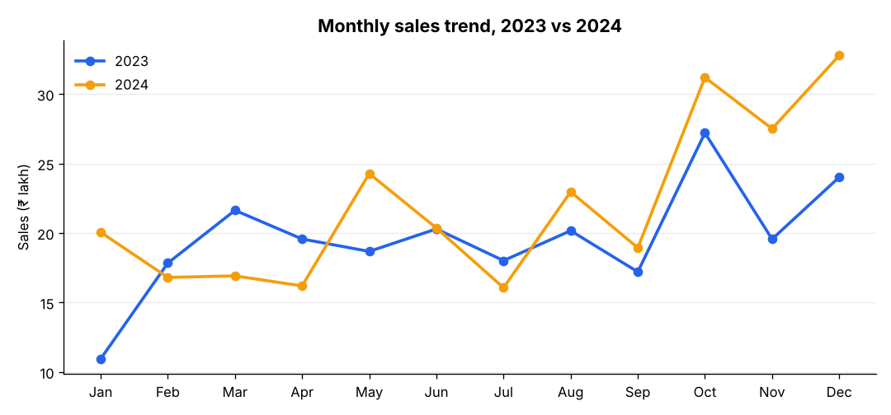
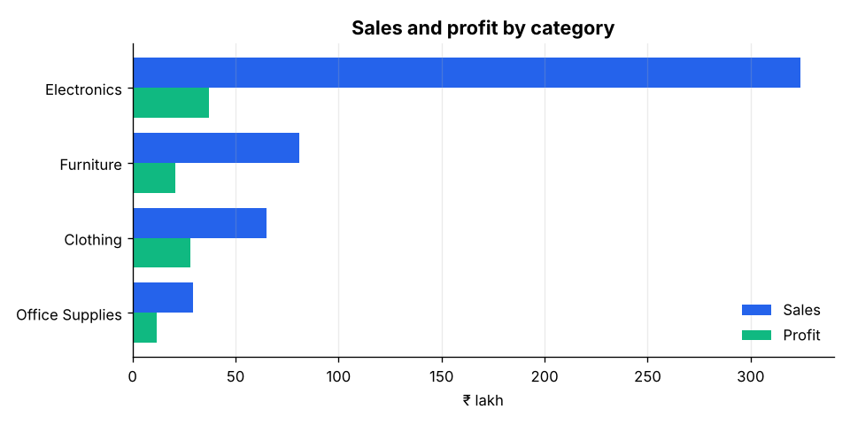
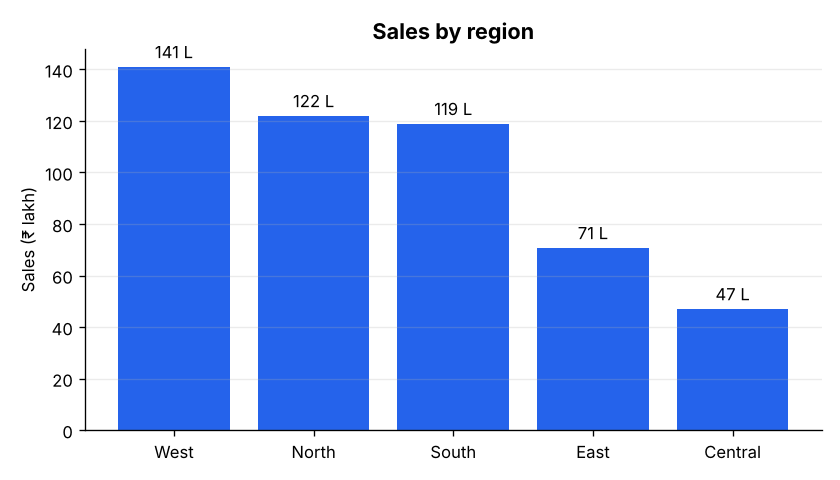
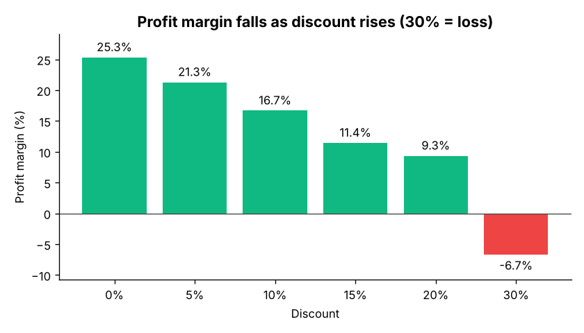

# Sales Trend Analyzer

End-to-end sales analysis of an Indian retail business (2023–2024): data cleaning in **Python**, business questions answered in **SQL (MySQL)**, and an interactive **Power BI** dashboard built with **DAX**.


## Business problem

A retail company selling electronics, furniture, office supplies and clothing across India wants to know:

- How are sales and profit trending month by month and year over year?
- Which categories, products and regions drive revenue and which lose money?
- How much do discounts hurt profit?
- How important is the festive season (October–November)?

## Key insights

| KPI | Value |
|---|---|
| Total sales | ₹4.99 Cr |
| Total profit | ₹97.68 L |
| Profit margin | 19.6% |
| Orders | 5,000 |
| Sales growth 2024 vs 2023 | +12.3% |

1. **Festive season matters.** October and November bring in about 21% of yearly sales.
2. **Electronics is 65% of sales, but Clothing has the best margin (43.5%).**
3. **Deep discounts wipe out profit.** Orders at 20%+ discount earn a 3.7% margin vs 21.2% below 20%; 30% discounts are loss-making.
4. **West is the top region; Central is the smallest**, which is a growth opportunity.

Full findings: [outputs/insights.md](outputs/insights.md)

## Charts

| Monthly trend | Category sales & profit |
|---|---|
|  |  |
| **Sales by region** | **Discount vs profit margin** |
|  |  |

### Power BI dashboard

<!-- After building the dashboard, add your screenshots here: -->
<!--  -->
<!--  -->

The dashboard has two pages: **Sales Overview** (KPI cards, monthly trend, category and region breakdown, slicers) and **Profit Deep Dive** (discount bands, category/sub-category matrix, top products, rolling average). Build steps are in [powerbi/BUILD_GUIDE.md](powerbi/BUILD_GUIDE.md) and all measures are in [powerbi/DAX_MEASURES.md](powerbi/DAX_MEASURES.md).

## Workflow

```
generate_data.py  →  data/raw/sales_raw.csv      (5,050 rows with quality issues)
clean_data.py     →  data/clean/sales_clean.csv  (5,000 clean rows)
analysis.py       →  outputs/charts + insights.md
sql/*.sql         →  MySQL database + 15 business queries
Power BI          →  interactive dashboard (DAX measures)
```

## Data cleaning

The raw file contains the problems you see in real data. `src/clean_data.py` fixes them:

| Problem | Fix |
|---|---|
| 50 duplicate orders (some with a missing value in one copy) | Remove exact duplicates, then keep the most complete row per `order_id` |
| Inconsistent text (`NORTH`, `  office supplies `) | Trim spaces and standardise casing |
| Missing `discount` | Recalculate from `sales ÷ (quantity × unit_price)` |
| Missing `sales` | Recalculate from `quantity × unit_price × (1 − discount)` |
| Missing `ship_mode` | Infer from shipping days (0 = Same Day, 1–3 = Express, 4+ = Standard) |
| Missing `segment` | Label as `Unknown` |

New columns added: `shipping_days`, `profit_margin`, `order_year`, `order_month`, `month_name`, `order_period`. The script ends with validation checks (unique IDs, no missing values, valid ranges).

## SQL analysis

[`sql/03_analysis_queries.sql`](sql/03_analysis_queries.sql) answers 15 business questions using:

- Aggregations with `GROUP BY` and `CASE`
- CTEs (`WITH`)
- Window functions: `LAG` (growth %), running totals, `RANK`, `ROW_NUMBER`, `NTILE` (Pareto analysis)

Example: month-over-month growth with a running total.

```sql
WITH monthly AS (
    SELECT order_period, SUM(sales) AS sales
    FROM sales_orders
    GROUP BY order_period
)
SELECT
    order_period,
    ROUND(sales, 2) AS sales,
    ROUND((sales - LAG(sales) OVER (ORDER BY order_period))
          / LAG(sales) OVER (ORDER BY order_period) * 100, 2) AS mom_growth_pct,
    ROUND(SUM(sales) OVER (ORDER BY order_period), 2)          AS running_total
FROM monthly;
```

## How to run

```bash
# 1. Install dependencies
pip install -r requirements.txt

# 2. (Optional) regenerate the raw data. The repo already includes it.
python data/generate_data.py

# 3. Clean the data
python src/clean_data.py

# 4. Run the analysis and create charts
python src/analysis.py
```

**MySQL:** run `sql/01_create_tables.sql`, then `sql/02_load_data.sql` (from the project folder), then the queries in `sql/03_analysis_queries.sql`.

**Power BI:** follow [powerbi/BUILD_GUIDE.md](powerbi/BUILD_GUIDE.md).

## Project structure

```
sales-trend-analyzer/
├── data/
│   ├── generate_data.py      # creates the sample dataset
│   ├── raw/sales_raw.csv
│   └── clean/sales_clean.csv
├── src/
│   ├── clean_data.py         # cleaning + validation
│   └── analysis.py           # KPIs, charts, insights
├── sql/
│   ├── 01_create_tables.sql
│   ├── 02_load_data.sql
│   └── 03_analysis_queries.sql
├── powerbi/
│   ├── BUILD_GUIDE.md
│   └── DAX_MEASURES.md
├── outputs/
│   ├── charts/
│   └── insights.md
└── requirements.txt
```

## About the data

The dataset is **synthetic**: it is generated by `data/generate_data.py` with a fixed random seed, so no real customer data is used. It is designed with realistic patterns (festive peaks, category margins, discount effects, regional differences) and realistic data quality issues for cleaning practice.

## Author

**Shubham Sharma** · [LinkedIn](https://www.linkedin.com/in/shubham-sharma-27aa38268) · [Portfolio](https://shubhamsharma1031.netlify.app/)
